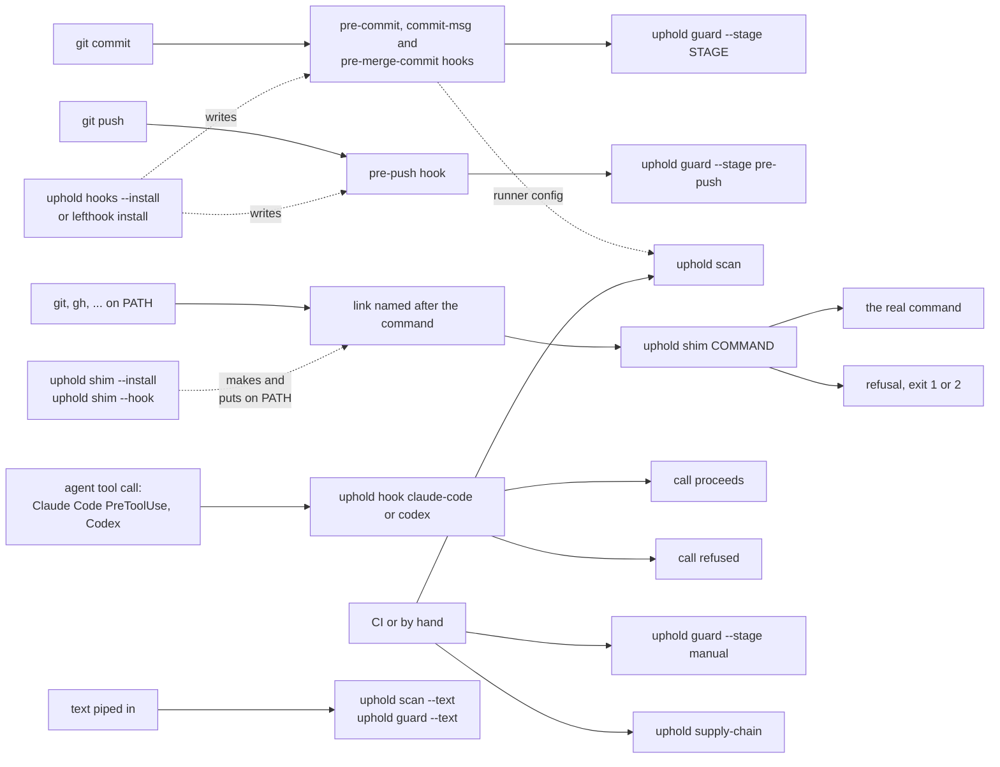

<!-- Generated by tests/workflow_doc.rs; do not edit by hand.
     Regenerate: UPHOLD_WORKFLOW_GOLDEN=bless cargo test --test workflow_doc -->

# How an action reaches uphold

Every path into uphold ends in one of a few commands. This page maps each way
in to the command it ends in, then lists the bundled rules that fire there.
It describes the tool; a repository's own rules are in its policy file, and
`uphold rules --effective` lists what one resolves to.

- **Git stages.** `uphold hooks --install` writes `pre-commit`, `commit-msg`,
  `pre-merge-commit` and `pre-push` as tracked files and points
  `core.hooksPath` at them; it refuses lefthook, which installs and owns its
  own hooks from the config `uphold init --lefthook` writes. Either way the
  stage ends in `uphold guard --stage STAGE`. A runner's config may also run
  `uphold scan` or `uphold supply-chain --staged` at `pre-commit`; those are
  the repository's choice, not the hook's.
- **Shim.** A link named for the command, on PATH ahead of the real one.
  `uphold shim --install` makes the links and `uphold shim --hook` keeps them
  on PATH only inside a tree that declares a policy. With no `[[shim]]` for the
  command, the real command runs untouched.
- **Agent harness.** `uphold hook` judges a pending tool call read on stdin. It
  exists for publishing that spawns no process, such as an MCP server, so it
  is configured for those tools rather than for shell commands.
- **CI and manual.** `uphold scan` reads the tree, `uphold guard --stage
  manual` runs the guards that sweep the whole repository, and `uphold
  supply-chain` runs the dependency and secret scanners.
- **Text.** `uphold scan --text` and `uphold guard --text` judge text with no
  path, such as a commit message.

## commit-msg

`uphold guard --stage commit-msg`, after `git commit` writes the message.

| Rule | Set | Message |
|---|---|---|
| `prevent-ai-author` | `commit-message-residue` | The `prevent-ai-author` guard writes its own report. |
| `prevent-unusual-unicode` | `commit-message-residue` | The `prevent-unusual-unicode` guard writes its own report. |
| `no-private-repo-names` | `private-names` | The `no-private-repo-names` guard writes its own report. |
| `removed-function-named` | `unnamed-removal` | The `removed-function-named` guard writes its own report. |

## pre-commit

`uphold guard --stage pre-commit`, over what is staged.

| Rule | Set | Message |
|---|---|---|
| `no-hand-copied-base-rule` | `process-residue` | A rule a bundled set already ships is written out here by hand, from a set this policy does not inherit. |
| `no-merge-commit` | `unreviewed-history` | The `no-merge-commit` guard writes its own report. |
| `prevent-author-mismatch` | `mismatched-author` | The `prevent-author-mismatch` guard writes its own report. |
| `prevent-unusual-unicode-in-files` | `invisible-characters` | The `prevent-unusual-unicode-in-files` guard writes its own report. |
| `no-private-repo-names-staged` | `private-names` | The `no-private-repo-names-staged` guard writes its own report. |

## pre-merge-commit

`uphold guard --stage pre-merge-commit`, when a merge is about to commit.

| Rule | Set | Message |
|---|---|---|
| `no-local-merge` | `unreviewed-history` | The `no-local-merge` guard writes its own report. |
| `prevent-author-mismatch` | `mismatched-author` | The `prevent-author-mismatch` guard writes its own report. |
| `prevent-unusual-unicode-in-files` | `invisible-characters` | The `prevent-unusual-unicode-in-files` guard writes its own report. |
| `no-private-repo-names-in-files` | `private-names` | The `no-private-repo-names-in-files` guard writes its own report. |

## pre-push

`uphold guard --stage pre-push`, over the range being pushed.

| Rule | Set | Message |
|---|---|---|
| `prevent-unusual-unicode-in-files` | `invisible-characters` | The `prevent-unusual-unicode-in-files` guard writes its own report. |
| `no-stale-visibility` | `stale-visibility` | The `no-stale-visibility` guard writes its own report. |
| `prevent-public-push` | `unowned-push` | The `prevent-public-push` guard writes its own report. |
| `no-private-repo-names-in-files` | `private-names` | The `no-private-repo-names-in-files` guard writes its own report. |

## manual

`uphold guard --stage manual`, from CI or by hand.

| Rule | Set | Message |
|---|---|---|
| `no-hand-copied-base-rule` | `process-residue` | A rule a bundled set already ships is written out here by hand, from a set this policy does not inherit. |
| `prevent-unusual-unicode-in-files` | `invisible-characters` | The `prevent-unusual-unicode-in-files` guard writes its own report. |
| `no-stale-hook-pins` | `stale-pins` | The `no-stale-hook-pins` guard writes its own report. |
| `no-stale-visibility` | `stale-visibility` | The `no-stale-visibility` guard writes its own report. |
| `no-private-repo-names-in-files` | `private-names` | The `no-private-repo-names-in-files` guard writes its own report. |

## shim

`uphold shim COMMAND`, in front of a command that publishes.

| Rule | Set | Message |
|---|---|---|
| `no-empty-merge-subject` | `published-text` | Give the merge commit a subject, or leave the subject off so the forge writes the pull request's title. |
| `no-published-host-identity` | `published-text` | Use neutral placeholders -- example-user, example-host, example.test, /srv/example -- instead of values taken from the local machine. |
| `no-published-markers` | `published-text` | Published text must satisfy the repository's text-capable guards. |
| `no-published-private-repo-names` | `published-text` | The `no-private-repo-names` guard writes its own report. |
| `ruling-citations-resolve` | `published-text` | The `ruling-citations-resolve` guard writes its own report. |
| `unowned-forge-target` | `published-text` | The `prevent-unowned-target` guard writes its own report. |
| `no-announcing-sentence` | `prose-shapes` | This sentence says what the next one will say. |
| `no-empty-hedge` | `prose-shapes` | This hedge admits no uncertainty -- it softens the claim without qualifying it. |
| `no-restating-clause` | `prose-shapes` | This clause restates the one in front of it. |
| `no-unproposed-alternative` | `prose-shapes` | This answers an objection nobody made. |

## agent hook

`uphold hook claude-code` and `uphold hook codex`.

| Rule | Set | Message |
|---|---|---|
| `no-empty-merge-subject` | `published-text` | Give the merge commit a subject, or leave the subject off so the forge writes the pull request's title. |
| `no-published-host-identity` | `published-text` | Use neutral placeholders -- example-user, example-host, example.test, /srv/example -- instead of values taken from the local machine. |
| `no-published-markers` | `published-text` | Published text must satisfy the repository's text-capable guards. |
| `no-published-private-repo-names` | `published-text` | The `no-private-repo-names` guard writes its own report. |
| `ruling-citations-resolve` | `published-text` | The `ruling-citations-resolve` guard writes its own report. |
| `no-announcing-sentence` | `prose-shapes` | This sentence says what the next one will say. |
| `no-empty-hedge` | `prose-shapes` | This hedge admits no uncertainty -- it softens the claim without qualifying it. |
| `no-restating-clause` | `prose-shapes` | This clause restates the one in front of it. |
| `no-unproposed-alternative` | `prose-shapes` | This answers an objection nobody made. |

## text

`uphold scan --text` and `uphold guard --text`.

| Rule | Set | Message |
|---|---|---|
| `no-empty-merge-subject` | `published-text` | Give the merge commit a subject, or leave the subject off so the forge writes the pull request's title. |
| `no-announcing-sentence` | `prose-shapes` | This sentence says what the next one will say. |
| `no-empty-hedge` | `prose-shapes` | This hedge admits no uncertainty -- it softens the claim without qualifying it. |
| `no-restating-clause` | `prose-shapes` | This clause restates the one in front of it. |
| `no-unproposed-alternative` | `prose-shapes` | This answers an objection nobody made. |

## scan

`uphold scan`, over the tree. A rule that reads files and has no git hook or published-text seam runs only here.

| Rule | Set | Message |
|---|---|---|
| `no-committed-logs` | `process-residue` | Keep captured logs in issues or ignored local storage. |
| `no-dated-source-metadata` | `process-residue` | Do not commit authoring dates in source or documentation. |
| `no-hardcoded-home-paths` | `process-residue` | Do not commit hardcoded user home paths. |
| `no-merge-conflict-markers` | `process-residue` | Do not commit Git merge-conflict markers. |
| `no-process-history-references` | `process-residue` | Do not reference process-history records (issue, pull request, or thread numbers) in final docs. |
| `no-source-changelog` | `process-residue` | Do not maintain change history in repository files. |
| `no-status-source-metadata` | `process-residue` | Do not commit workflow-state metadata in source docs. |
| `no-task-tracker-references` | `process-residue` | Source, configuration, and documentation must not depend on volatile issue or pull request records. |
| `no-tracked-private-data-paths` | `process-residue` | Do not commit local private data, build artifacts, traces, or HAR captures. |
| `no-task-tracker-references-in-code` | `code-residue` | Source, configuration, and build files must not depend on volatile issue or pull request records. |
| `no-browser-profile-artifacts` | `credentials` | Do not commit browser profile or session-store files. |
| `no-env-secret-values` | `credentials` | Do not commit populated environment files. |
| `no-pinned-release-download` | `unmanaged-pins` | Do not fetch a pinned release artifact by URL. |
| `no-pinned-tool-install` | `unmanaged-pins` | Do not pin a tool version in an install command. |
| `no-pinned-versioned-fetch` | `unmanaged-pins` | Do not curl or wget a versioned URL. |
| `no-running-os-identity-metadata` | `host-identity` | Do not commit identity metadata from the running OS. |
| `no-broken-doc-links` | `broken-links` | A documentation link points at a path that does not exist, or escapes the repository. |
| `no-non-ascii-in-fixtures` | `captured-fixtures` | A test fixture holds non-ASCII content, which is what a capture from a live upstream looks like and is not what a synthetic fixture looks like. |
| `no-stale-anchored-fact` | `doc-claims` | A document states a fact that has moved. |
| `workflow-declares-permissions` | `default-token-grant` | A GitHub Actions workflow declares no top-level `permissions:` block, so its GITHUB_TOKEN gets whatever default the repository, organization or enterprise settings grant -- a scope decided outside this file and invisible in it. |
| `no-hand-rolled-tool-install` | `hand-rolled-toolchain` | Do not download and unpack a tool by hand. |
| `no-hand-rolled-tool-symlink` | `hand-rolled-toolchain` | Do not symlink a hand-installed tool onto PATH out of `$HOME/.local`. |
| `no-restated-line` | `comment-facts` | This comment says what the next line already says. |
| `no-user-data-measurement` | `comment-facts` | This comment states a measurement, and no anchor checks it -- the value was true when it was written and nothing fails when it stops being. |
| `no-announcing-sentence` | `prose-shapes` | This sentence says what the next one will say. |
| `no-empty-hedge` | `prose-shapes` | This hedge admits no uncertainty -- it softens the claim without qualifying it. |
| `no-restating-clause` | `prose-shapes` | This clause restates the one in front of it. |
| `no-unproposed-alternative` | `prose-shapes` | This answers an objection nobody made. |
| `no-narrated-history` | `narrated-history` | This sentence narrates how something changed. |
